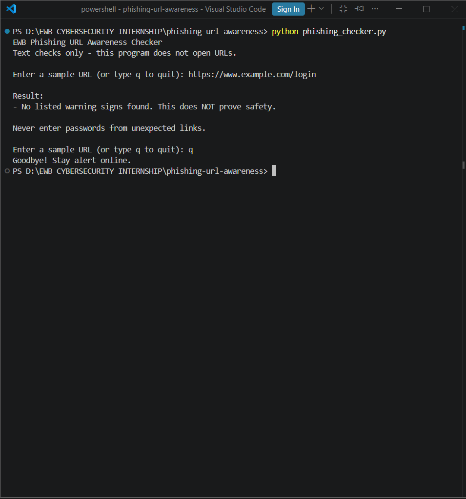
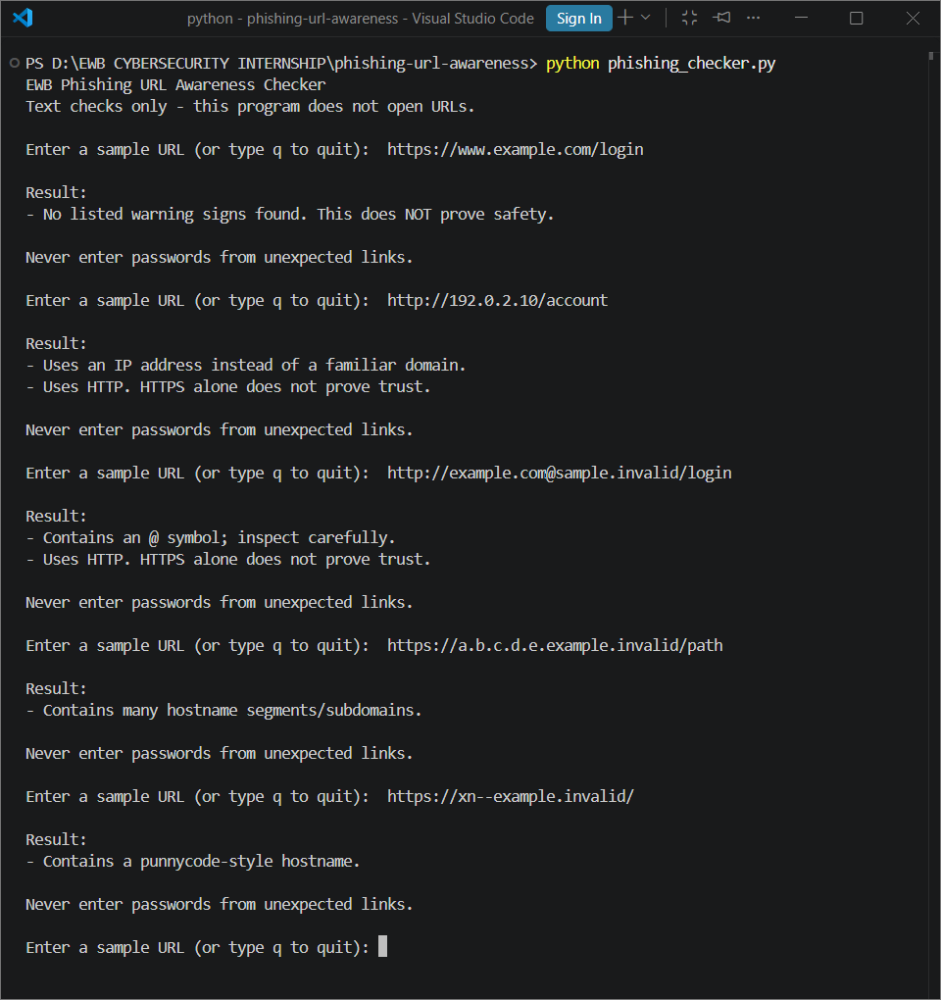

# EWB Phishing URL Awareness Checker
## Overview
Phishing is a trick where a criminal sends a fake link or message to make you share a password, card number, or OTP. The fake link often looks like a real one. This project is a small command-line tool that inspects the text of a URL for a few visible warning signs.

## Features
- Detects an @ symbol in the URL
- Flags unusually long URLs (over 100 characters)
- Flags IP-address hostnames
- Flags many hostname segments (5 or more)
- Flags punycode-style hostnames (xn--)
- Flags the HTTP scheme
- Allows the user to check multiple URLs continuously without restarting.
- Formats the warning results into a clean, easy-to-read bulleted list.

## Requirements
Python 3.10 or later. No extra packages.

## How to Run
Windows:   python phishing_checker.py
Mac/Linux: python3 phishing_checker.py

## Example Output
PS D:\EWB CYBERSECURITY INTERNSHIP\phishing-url-awareness> python phishing_checker.py
EWB Phishing URL Awareness Checker
Text checks only - this program does not open URLs.
Enter a sample URL to inspect: https://www.example.com/login

Result:
- No listed warning signs found. This does NOT prove safety.

Never enter passwords from unexpected links.
PS D:\EWB CYBERSECURITY INTERNSHIP\phishing-url-awareness> 

## Testing
| # | Input | Expected | Actual | Result |
|---|-------|----------|--------|--------|
| 1 | https://www.example.com/login | No warning signs | [No listed warning signs found. This does NOT prove safety] | [PASS] |
| 2 | http://192.0.2.10/account | IP address + HTTP | Uses an IP address instead of a familiar domain + Uses HTTP. HTTPS alone does not prove trust | [PASS] |
| 3 | http://example.com@sample.invalid/login | @ symbol + HTTP | Contains an @ symbol; inspect carefully + Uses HTTP. HTTPS alone does not prove trust | [PASS] |
| 4 | https://a.b.c.d.e.example.invalid/path | Many hostname segments | Many hostname segments | Contains many hostname segments/subdomains | [PASS] |
| 5 | https://xn--example.invalid/ | Punycode-style hostname |  Contains a punnycode-style hostname | [PASS] |

## Screenshots

## Improvements
1. Option A (Loop with quit) - Replaced the single run in main() with a while True loop so the user can check multiple URLs without restarting the program. I tested it by entering multiple URLs and then typing 'q' to ensure it exits smoothly.
2. Option E (Improve output formatting) - Improved terminal readability by adding newline characters before the results and formatting the findings as a clean bulleted list. I tested it by running the script to ensure the text wasn't clustered together and was easy to read.

## Limitations
This is an educational tool. It only reads URL text. It does not visit
URLs, scan for malware or prove that a URL is safe. No warning signs
found does NOT mean a URL is safe.

## Ethical Use
Use sample strings only. Do not collect credentials. Do not use this
project to deceive anyone or to test websites without permission.

## Author
Kartikey Singh, 
EWB Cyber Security Internship — Batch 1, EWB Courses